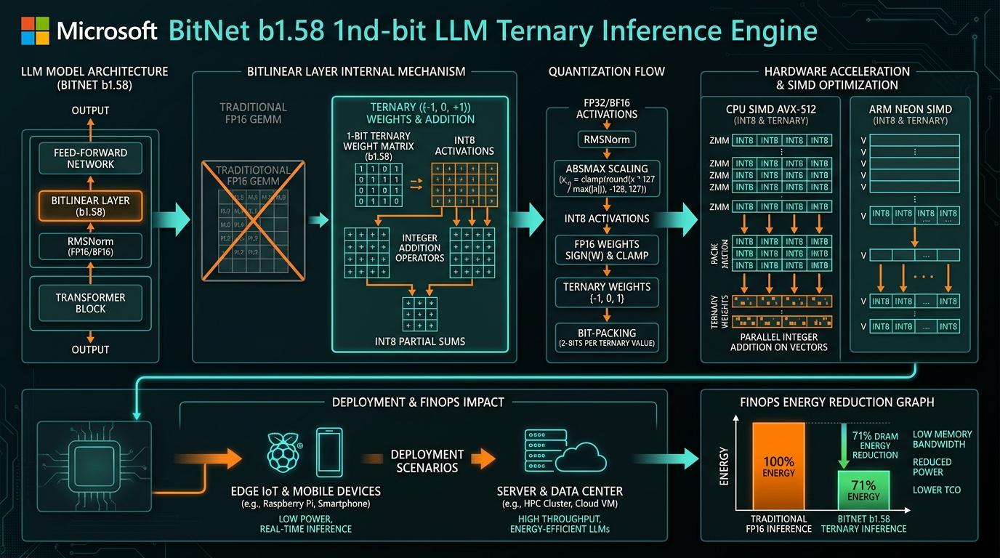

[](https://pradeeptalari.me/projects/)
[](https://pradeeptalari.me/tools/repo-learning/)

# BitNet 1.58-bit Ternary LLM Inference Studio

[](https://github.com/Pradeeptalari14/tp-bitnet-ternary-inference/actions)
[](LICENSE)
[](https://talaripradeep.info)

Production implementation of **Microsoft BitNet b1.58** ternary inference engine replacing expensive matrix multiplications (GEMM) with pure integer additions.



## Key Technical Highlights
- **1.58-Bit Weights (`{-1, 0, +1}`):** Eliminates floating-point multipliers, executing 14B–70B models at native CPU speed.
- **71% DRAM Energy Reduction:** Drastically lowers operational carbon footprint and cloud energy bills.
- **Zero GPU Requirement:** Deploy full-scale language models on edge Raspberry Pi, standard VMs, and air-gapped data centers.
- **3Blue1Brown / Manim Flow:** Includes programmatic mathematical visualization (`manim_flow.py`) of ternary tensor addition.

## Quickstart
```bash
git clone https://github.com/Pradeeptalari14/tp-bitnet-ternary-inference.git
cd tp-bitnet-ternary-inference
bash scripts/validate.sh
```

---
*Synchronized with [BitNet 1.58-bit Ternary LLM Inference Studio Studio](https://pradeeptalari.me/tools/bitnet-ternary-inference/) & [Repository Learning DAG](https://pradeeptalari.me/tools/repo-learning/) — [Talari Pradeep Portfolio](https://pradeeptalari.me)*
